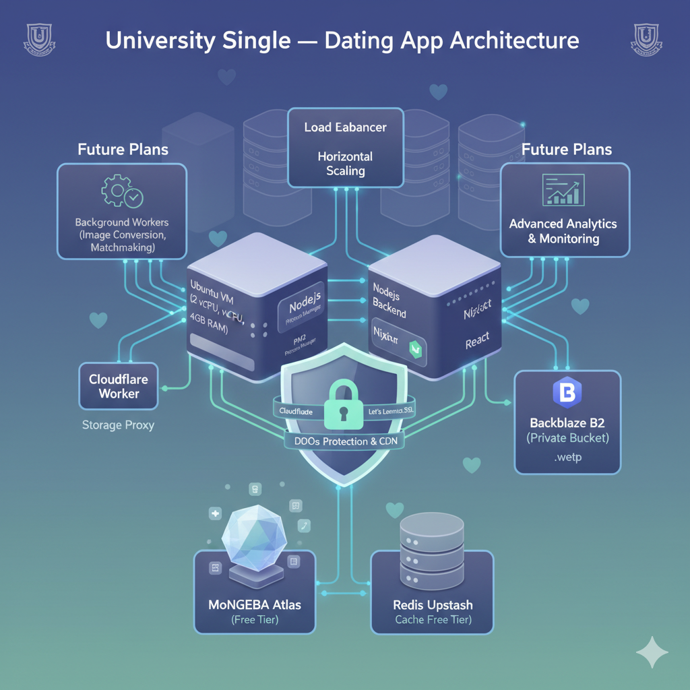

# 💘 University Single — Dating App

A modern dating app built for university students, designed for performance, scalability, and privacy.  
This document outlines the current infrastructure setup and technical stack.

---

## 🧱 Current Architecture

> _The diagram above illustrates the full architecture — from frontend delivery to backend, storage, and CDN layers._

---

## ⚙️ Current Setup Overview

### 🔒 SSL
- **Provider:** Let’s Encrypt SSL (auto-renewed)
- **Purpose:** Secure all client–server communication (HTTPS)

### 🖥️ Backend
- **Runtime:** Node.js
- **Process Manager:** PM2
- **Purpose:** Handles matchmaking logic, authentication, chat, and APIs

### 💅 Frontend
- **Framework:** React  
- **Served by:** Nginx (static build hosting)
- **Purpose:** User interface, chat system, and matchmaking frontend

### 🗂️ Storage
- **Provider:** Backblaze B2 (private bucket)
- **Proxy:** Cloudflare Worker
- **Behavior:**  
  - On image upload, the server converts images to `.webp`
  - Stores optimized images in the B2 bucket

### 🧩 Database
- **Primary:** MongoDB Atlas  
  - _Currently using the free tier; planning to upgrade with growth_
- **Secondary / Cache:** Redis (Upstash free tier)  
  - _Used for sessions, caching, and real-time features_

### 🌍 CDN / Proxy
- **Provider:** Cloudflare (Free tier)  
- **Purpose:** DDoS protection, caching, SSL termination, and Worker proxying

### 🖥️ Server Specs
- **OS:** Ubuntu Linux (VM)
- **Specs:** 2 vCPU, 4 GB RAM
- **Purpose:** Hosts backend (Node.js) and Nginx frontend

---

## 🚀 Future Plans
- Upgrade MongoDB and Redis tiers for scaling
- Add background workers for image conversion and matchmaking tasks
- Integrate load balancer for horizontal scaling
- Implement advanced analytics and monitoring

---

## 🧭 Tech Stack Summary
| Layer | Technology |
|-------|-------------|
| Frontend | React + Nginx |
| Backend | Node.js + PM2 |
| Database | MongoDB Atlas |
| Cache | Redis (Upstash) |
| Storage | Backblaze B2 + Cloudflare Worker |
| CDN / Proxy | Cloudflare |
| SSL | Let’s Encrypt |
| OS / Server | Ubuntu VM (2 vCPU, 4GB RAM) |

---

## Code by

https://jules.google.com/
