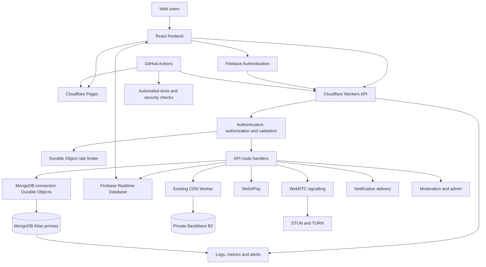

# Dating App Platform: Complete Product Mindmap

**Last updated:** 2026-11-11  
**Repository branch:** `migrate-to-serverless`  
**Document status:** Product and architecture blueprint. This document describes the target product and architecture; it does not assert that every capability is implemented or production-validated.

## 1. Product scope

The platform combines dating discovery, matching, messaging, real-time communication, video rooms, paid services, identity verification, moderation, and administration. The product must prioritise user safety, privacy, reliable matching, low background traffic, and measurable performance.

## 2. Master mindmap

```mermaid
mindmap
  root((Dating App Platform))
    Product Experience
      Registration and login
        Email and mobile
        Google sign-in
        Firebase authentication
        Verification and recovery
      Profile
        Photos and videos
        Bio and interests
        Gender and orientation
        Age and location
        Relationship intentions
        Education and occupation
        Profile completion
      Preferences
        Show men, women or everyone
        Age range and distance
        Location and interests
        Verified profiles
      Navigation
        Discover
        Likes and matches
        Conversations
        Video rooms
        Services
        Notifications
        Profile and settings
    Discovery and Matching
      Profile feed
      Like, pass and super like
      Undo swipe
      Mutual-like matching
      Recommendation ranking
      Compatibility signals
      Pagination and exclusions
      Blocked and suspended account filtering
    Likes and Matches
      Received likes
      Sent likes
      Match list
      Match lifecycle
      Unmatch
      Match reporting and blocking
      Premium likes features
    Messaging
      Conversations
      Text and media messages
      Voice messages
      Read and delivery state
      Reactions and replies
      Typing and presence
      Firebase real-time listeners
      Offline and reconnect handling
      Chat abuse controls
    Video and Live Rooms
      One-to-one calls
      Public rooms
      Private rooms
      Room booking
      Host and participant controls
      WebRTC signalling
      STUN and TURN
      Automatic bandwidth adaptation
      Audio-first degradation
      Adaptive video bitrate, resolution and frame rate
      WebRTC statistics and quality monitoring
      Call data-usage measurement and validation
      Paid sessions
      Room moderation
    Trust and Verification
      Email and mobile verification
      Selfie and liveness checks
      Face comparison
      Verified badge lifecycle
      Duplicate and bot detection
      Evidence encryption and retention
      Manual review
    Monetisation
      Free, weekly, monthly and annual plans
      Premium entitlements
      Store products
      Gallery access
      Unlimited Pass
      Creator Gallery
      Video room bookings
      WebXPay payment flow
      Callback verification
      Refunds and reconciliation
      Idempotent purchase processing
    Notifications
      Likes and matches
      Messages and calls
      Verification and moderation
      Payment and subscription
      In-app and push delivery
      Preferences and quiet hours
      Deduplication and retries
    Safety and Moderation
      Report user and content
      Block and unblock
      Unmatch
      Report queue and case assignment
      Evidence review
      Warnings and restrictions
      Suspension and bans
      Appeals and escalation
      Moderator audit trail
      Account and IP rate limits
    Administration
      Operational dashboard
      User and account management
      Moderation queue
      Payment and subscription management
      Content configuration
      Feature flags
      Role-based admin access
      Audit history
    Backend and Data
      React frontend on Cloudflare Pages
      Cloudflare Workers API
      Durable Objects
      MongoDB Atlas primary database
      Firebase RTDB chat integration
      Existing CDN Worker
      Private Backblaze B2 media storage
      WebXPay
      WebRTC infrastructure
      MongoDB collections and indexes
      Data integrity and retention
    Security and Privacy
      Firebase token verification
      Authentication and resource authorization
      Role-based access
      Input validation
      Rate limiting
      Secret management
      Encryption
      Hide email and mobile
      Location privacy
      Data export and deletion
      OWASP testing
      Security regression tests
    Performance and Scale
      Reduce idle polling
      Event-driven updates
      Request deduplication
      Cursor pagination
      Query and index optimisation
      Connection pool sizing
      Durable Object sharding
      Safe caching
      Image optimisation
      Load tests from 1k to 15k users
      P95 and P99 monitoring
    Operations
      GitHub Actions
      Staging deployments
      Automated tests
      Smoke and readiness checks
      Logs and metrics
      Alerting
      Incident response
      Rollback procedures
    Compliance and Growth
      Age eligibility and consent
      Terms and privacy policy
      Data retention policy
      Regional requirements
      Acquisition analytics
      Engagement and retention
      Match and conversation funnel
      Revenue analytics
      A/B testing
      Future mobile apps and communities
```

## 3. User journeys

### 3.1 Registration to discovery
1. User opens the application and registers or signs in.
2. Authentication is validated by the backend.
3. User completes profile details and adds photos.
4. User sets gender, age, distance, location, and relationship preferences.
5. Discovery returns eligible profiles using pagination and exclusion rules.
6. User likes, passes, or super-likes a profile.

### 3.2 Like to match to conversation
1. Record the swipe with an idempotent operation.
2. Check for a reciprocal like.
3. Create one match record if the reciprocal like exists.
4. Notify both users without creating duplicate notifications.
5. Create or resolve conversation metadata.
6. Use the existing Firebase real-time chat integration for message updates.
7. Enforce block, unmatch, and account-status restrictions on every relevant operation.

### 3.3 Report and moderation
1. User submits a report with a category and optional explanation.
2. Validate the target, reporter, and report eligibility.
3. Apply account-scoped rate limits and duplicate-report controls.
4. Create a moderation case and audit event.
5. Moderator reviews the case and records an outcome.
6. Apply warning, restriction, suspension, or ban when justified.
7. Preserve an auditable history and support appeals where applicable.

### 3.4 Purchase and entitlement
1. User selects a plan or store item.
2. Backend validates price, product, account, and eligibility.
3. Create an idempotent payment attempt.
4. Redirect or open the supported WebXPay payment flow.
5. Verify the payment result server-side. Never trust a client success redirect alone.
6. Activate the entitlement exactly once.
7. Reconcile payment and entitlement state; support expiry, cancellation, and refunds.

## 4. Technical architecture

### Architecture boundaries
- **Frontend:** React application deployed through Cloudflare Pages.
- **API:** Cloudflare Workers provide the API surface and legacy route compatibility.
- **Primary database:** MongoDB Atlas is the authoritative application database.
- **Connection coordination:** Durable Objects manage MongoDB connection instances and account-scoped rate limiting.
- **Chat:** Keep the existing Firebase Realtime Database integration and listeners.
- **Media:** Keep the existing CDN Worker and private Backblaze B2 integration unchanged. Application media traffic must continue through the configured CDN hostname.
- **Payments:** WebXPay payment state must be verified server-side and processed idempotently.
- **Calls:** WebRTC requires signalling plus suitable STUN/TURN connectivity. TURN capacity and cost must be tested separately.
- **Cache:** Start with safe Cloudflare-native caching and request reduction. Do not cache private or user-specific data in a shared cache. Redis is not assumed to be deployed.

### One-to-one call quality policy

- Automatic quality is the default. Do not require users to choose a quality profile.
- Preserve intelligible audio as the highest priority when bandwidth degrades.
- Adapt video bitrate, frame rate and resolution using WebRTC statistics, with hysteresis to avoid oscillation.
- Reduce or pause video before intentionally interrupting audio.
- Treat bitrate settings as targets, not hard data caps. Validate real bytes sent/received on representative devices and networks.
- Current source includes an initial automatic controller; end-to-end and data-usage acceptance is pending. GitHub Actions quota exhaustion currently blocks the normal CI/deployment evidence path.

## 5. Functional module requirements

| Module | Core requirements | Key acceptance tests |
|---|---|---|
| Authentication | Registration, login, recovery, token validation | Invalid, expired and revoked token tests |
| Profile | Profile CRUD, media references, visibility | Ownership and sensitive-field exposure tests |
| Discovery | Preference filters, exclusions, pagination | Gender, age, distance, block and duplicate tests |
| Swipe and match | Like, pass, super-like, mutual match, undo | Concurrency and duplicate-match tests |
| Messaging | Conversation access, messages, read state | Blocked-user and unauthorized conversation tests |
| Video | Calls, rooms, participant controls | Permission, reconnection and TURN tests |
| Verification | Selfie workflow, review, badge state | Evidence access and verification-state tests |
| Payments | Checkout, callback, entitlement, refunds | Forged callback and duplicate payment tests |
| Notifications | Event-driven delivery and preferences | Deduplication and retry tests |
| Moderation | Report, block, unmatch, enforcement, audit | Ordinary-user/admin authorization tests |
| Admin | Roles, dashboards, case and payment management | Role and audit coverage |
| Operations | Deployment, logs, metrics, rollback | Smoke, readiness and rollback exercises |

## 6. Data domains and integrity

The following are logical data domains. They are not a declaration that every item already exists as a separate MongoDB collection.

- **Identity and profile:** user account, profile fields, preferences, verification status.
- **Discovery:** swipe events, likes, ranking signals, exclusion rules.
- **Matching:** match records, match state, unmatch history.
- **Communication:** conversation metadata, message references, read state. Message transport remains integrated with Firebase as currently designed.
- **Commerce:** payment attempts, transactions, subscription records, entitlements, refunds.
- **Trust and safety:** reports, blocks, moderation cases, enforcement actions, audit events.
- **Operations:** idempotency records, delivery state, diagnostic and audit metadata where required.

Data rules:
- Use unique indexes for identities and duplicate-sensitive operations.
- Index actual query patterns, including user IDs, match participants, conversation membership, subscription references, and timestamps.
- Use geospatial indexes only where the stored location model and privacy policy support them.
- Use atomic updates or transactions for operations that must change together.
- Make payment callbacks, match creation, and notification delivery idempotent.
- Define retention and deletion behaviour for user content, reports, payment records, and verification evidence.
- Avoid storing sensitive data that the application does not need.

## 7. Security and privacy controls

- Verify Firebase ID tokens server-side. Decoding a token payload is not authentication.
- Enforce resource ownership and role checks on every protected API operation.
- Treat client-supplied user IDs, subscription states, prices, and payment outcomes as untrusted.
- Hide email addresses and mobile numbers from ordinary profile responses.
- Keep secrets in Cloudflare/GitHub secret stores, never in frontend bundles or source control.
- Validate and constrain uploads, file types, size, ownership, and media access.
- Rate-limit sensitive account actions and fail safely when required enforcement infrastructure is unavailable.
- Ensure blocking prevents discovery, messaging, calling, and other contact paths.
- Keep moderation actions auditable and restrict evidence access.
- Test IDOR, privilege escalation, injection, authentication bypass, abuse, and rate-limit bypass.
- Provide account deletion and data handling according to applicable legal and retention requirements.

## 8. Performance and scalability plan

Target stages are test milestones, not current capacity claims.

| Stage | Load-test objective | Required evidence |
|---|---:|---|
| Baseline | 100 concurrent users | Correctness and baseline latency |
| Stage 1 | 1,000 concurrent users | Stable API and database behaviour |
| Stage 2 | 2,500 concurrent users | No unexpected connection or queue saturation |
| Stage 3 | 5,000 concurrent users | Stable p95/p99 and error rate |
| Stage 4 | 10,000 concurrent users | Sustained load and recovery validation |
| Stage 5 | 15,000 concurrent users | Capacity, cost and failure-mode evidence |

Optimisation work:
1. Remove unnecessary polling and use event-driven updates where possible.
2. Prevent duplicate API calls and duplicate Firebase listeners.
3. Use cursor pagination for discovery, conversations, and other growing lists.
4. Measure slow MongoDB queries and build indexes from observed query patterns.
5. Set pool sizes based on Atlas tier limits and measured concurrency.
6. Validate Durable Object shard distribution and hot-key behaviour.
7. Cache only data that is safe to share, with explicit cache keys and invalidation.
8. Optimise image sizes and frontend bundle loading.
9. Measure Worker CPU, request volume, Durable Object throughput, MongoDB connections, Firebase traffic, and TURN usage.
10. Test graceful degradation, retries, timeouts, and recovery after load.

Proposed service objectives for validation:
- Read API p95: under 500 ms.
- Write API p95: under 800 ms.
- Error rate: under 1% during the agreed normal-load test.
- No cross-user cache leakage or authorization failures.
- No duplicate charges, entitlements, matches, or moderation actions under retries.

These are engineering targets and must be confirmed by repeatable tests before being treated as achieved.

## 9. Monitoring and operations

Monitor:
- Cloudflare Worker requests, errors, CPU/execution duration, and Durable Object activity.
- MongoDB Atlas connections, query latency, slow queries, and index use.
- Frontend JavaScript errors and API request volume.
- Firebase listener and message delivery behaviour.
- Payment initiation, callback verification, reconciliation, and failure rates.
- WebRTC connection success, TURN relay usage, and call quality.
- Moderation queue age and report resolution.
- Deployment status, smoke tests, and rollback readiness.

Operational practices:
- Keep all migration work on `migrate-to-serverless`.
- Use GitHub Actions for tests and Cloudflare deployments.
- Validate staging before production changes.
- Keep secrets out of logs and build artifacts.
- Maintain a rollback procedure and incident runbook.

## 10. Delivery roadmap

### P0: Core reliability and safety
- Authentication and authorization coverage.
- Profile and discovery correctness.
- Swipe and match integrity.
- Messaging access controls.
- Report, block, and unmatch workflows.
- Admin moderation audit history.
- Abuse prevention and security regression tests.
- Remove unnecessary background polling.

### P1: Trust, payments and performance
- Complete selfie verification lifecycle.
- Complete payment and subscription reconciliation.
- Event-driven notifications.
- Database query and index review.
- Safe caching and request deduplication.
- Staged load testing through 1,000 and 2,500 concurrent users.

### P2: Communication and scale
- Video room reliability and moderation.
- Paid room booking and billing.
- Load testing at 5,000 and 10,000 concurrent users.
- Capacity and cost review for MongoDB, Workers, Firebase, and TURN.

### P3: Product expansion
- 15,000 concurrent-user validation.
- Improved recommendation quality.
- Advanced analytics and experimentation.
- Events, communities, voice introductions, and mobile applications.

## 11. Definition of done

A feature is complete only when all applicable items are satisfied:

- [ ] User experience implemented and accessible.
- [ ] Backend behaviour implemented.
- [ ] Data model and indexes reviewed.
- [ ] Authentication and authorization enforced.
- [ ] Input validation and error handling implemented.
- [ ] Rate limits and abuse controls implemented where needed.
- [ ] Unit and integration tests pass.
- [ ] End-to-end journey passes.
- [ ] Security regression tests pass.
- [ ] Staging deployment succeeds.
- [ ] Staging smoke tests pass.
- [ ] Monitoring and operational ownership are defined.
- [ ] Performance evidence exists for scale-sensitive features.
- [ ] Documentation reflects actual deployed behaviour.

## 12. Scope and status disclaimer

This mindmap is the master product blueprint and delivery checklist. Existing infrastructure and previously implemented features should be verified against the repository and staging environment before being marked complete. A planned feature, passing unit test, successful deployment, and production-validated capability are four different statuses.

## Completeness, ownership and verification gaps (2026-11-11)

Treat this specification as a living contract. For each item, record implementation status, automated test, staging evidence, last verified commit, owner, dependency, and rollback/retention impact. Distinguish documented design from verified runtime behaviour. Reconcile against source and staging before release.

Cross-cutting gaps requiring explicit closure: a complete API route/method/authz/schema/error catalogue; MongoDB collection schemas, indexes, uniqueness, TTL and migration/rollback definitions; Firebase RTDB rules and push subscription/delivery/retry lifecycle; tested backup/restore with RPO/RTO; payment replay/idempotency/reconciliation/refund and stale-pending recovery; moderation message edit/delete permissions and immutable audit events; account export/deletion propagation and backup retention; supported browser/device, PWA/offline and notification permission matrix; accessibility checks for keyboard, screen readers, contrast and forms; localization, timezone and RTL readiness. Do not imply these are implemented unless backed by evidence.

## 13. Intent-first dating product expansion (2026-11-18)

The product direction is a unified combination of three interaction patterns, with original branding and interaction design:

- **Fast swipe discovery (Tinder-inspired):** profile cards, like/pass, optional Super Like, undo and mutual matches.
- **Intentional interaction (Bumble-inspired):** configurable first-move preferences, prompt-first openers, conversation invitations and respectful response reminders. Do not enforce gender stereotypes.
- **Flexible relationship exploration (Feeld-inspired):** optional identity and relationship-intention taxonomy, interests/desire tags, glossary, consensual linked profiles, group discovery, Pings and privacy controls.

The differentiator is intent-first, privacy-first dating. Relationship tags are not consent. Sensitive identity and desire fields are optional, private by default, excluded from advertising and protected by strict access controls.

See [Relationship Discovery, Intent and Consent Specification](./features/RELATIONSHIP_DISCOVERY_INTENT_AND_CONSENT_SPEC.md) for the detailed profile model, eligibility and ranking rules, first-move settings, Pings, partner-link/group-consent lifecycle, private media, safety requirements, logical data model, API domains, phases and acceptance criteria.

Delivery sequence: (0) jurisdiction, age assurance, privacy and threat-model foundation; (1) individual profile intentions, tags, glossary and discovery filters; (2) first-move controls, Pings, incognito and private media; (3) consensual two-person profile links; (4) group discovery and group chat only after per-member consent and moderation acceptance; (5) ranking and monetisation optimisation. Core safety and consent must remain free.

These are planned capabilities, not implementation claims. Preserve Cloudflare Pages/Workers, MongoDB Atlas, Firebase RTDB chat and the existing CDN Worker. Reconcile proposed data entities with the active Worker database catalogue before migrations.
